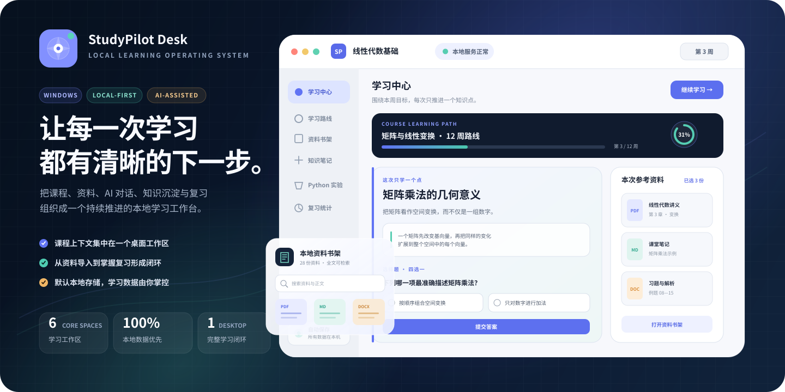
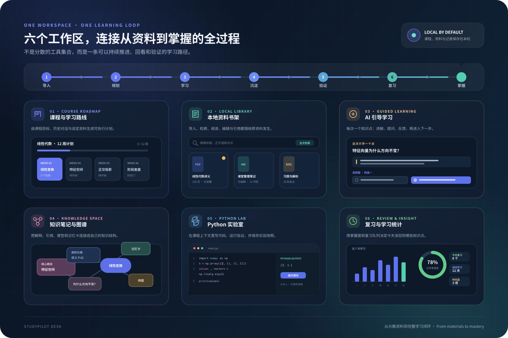
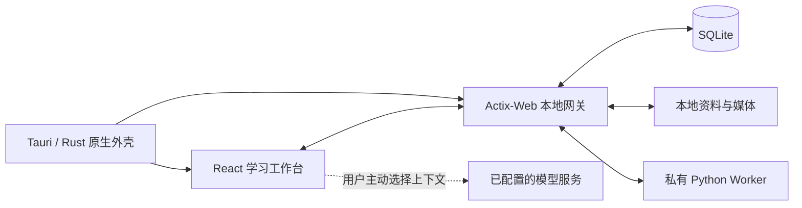

<p align="center">
  
</p>

<p align="center"><strong>From scattered materials to a complete learning loop.</strong></p>
<p align="center">把课程、资料、AI 对话、知识沉淀与复习，组织成一个持续推进的本地学习工作台。</p>

<p align="center">
  
  
  
  
  
</p>

<p align="center">
  <a href="#为什么是-studypilot-desk">产品理念</a> ·
  <a href="#主要功能">主要功能</a> ·
  <a href="#获取应用">获取应用</a> ·
  <a href="#一分钟启动">一分钟启动</a> ·
  <a href="#系统如何运作">技术架构</a> ·
  <a href="#数据安全与隐私">隐私边界</a>
</p>

---

## 为什么是 StudyPilot Desk

| 聚合学习上下文 | 推进完整学习闭环 | 数据默认留在本机 |
| --- | --- | --- |
| 课程、资料、对话、笔记、代码实验和复习记录不再散落在多个工具。 | 从资料导入、路线规划到知识点讲解、问题验证和间隔复习，每一步都有下一步。 | SQLite、课程资料、媒体与学习记录默认保存在本地；外部模型只接收用户主动选择的上下文。 |

StudyPilot Desk 不是一个只负责聊天的 AI 外壳，也不是单纯的资料阅读器。它更像一个面向长期学习的桌面操作系统：先理解课程与资料，再持续组织行动、证据和复习。

## 主要功能

<p align="center">
  
</p>

| 工作区 | 能做什么 | 工作区 | 能做什么 |
| --- | --- | --- | --- |
| **课程与学习路线** | 统一管理课程；根据目标、历史对话和选定资料生成可执行的周计划。 | **本地资料书架** | 导入 PDF、DOCX、Markdown、TXT 等资料，全文检索、阅读、引用与管理。 |
| **AI 引导学习** | 每轮聚焦一个知识点，以讲解、选择题或开放题、反馈组成连续学习过程。 | **知识笔记与图谱** | 用概念、便签、记忆卡、资料引用和连线沉淀自己的知识结构。 |
| **Python 实验室** | 发现本机 Python 环境，在课程上下文中编辑、运行、停止并保存实验快照。 | **复习与学习统计** | 记录掌握度、错因和复习队列，让今天需要巩固的内容清晰可见。 |

此外还包括多课程书架、语言学习模式、模型配置、自由知识画布、项目研究工作台、本地备份与恢复、深浅主题、系统字体和可访问性设置。完整边界见 [产品范围](docs/PRODUCT_SCOPE.md) 与 [已知限制](docs/KNOWN_LIMITATIONS.md)。

## 获取应用

当前发布线为 **0.2.x**。Windows 用户可前往 [GitHub Releases](https://github.com/KleeAlice/studypilot-desk/releases) 下载 `StudyPilot Desk_*_x64-setup.exe`；也可以按下方方式直接从源码启动。项目同时保留 Linux、macOS 与移动端适配基础，具体支持范围以每个 Release 的资产和说明为准。

> Windows 未签名安装包可能触发 SmartScreen 提示，请只从本仓库 Release 下载。

## 一分钟启动

### 环境要求

- Windows 10 / 11（桌面开发与安装包）
- Node.js 20+
- Python 3.10+
- Rust stable 工具链与 Visual Studio C++ Build Tools（仅源码构建桌面端时需要）
- 首次安装依赖时可访问 npm 与 PyPI

### 直接启动

双击 `start.bat`，或在 PowerShell 中运行：

```powershell
.\start.ps1
```

首次启动会创建 `.venv`、安装 Python / Node 依赖并启动 Tauri 桌面端。之后可直接复用现有环境；运行数据默认保存在 `data/`，该目录不会进入 Git。

仅启动浏览器版：

```powershell
npm.cmd run dev:web
```

Tauri 桌面开发模式：

```powershell
npm.cmd run dev
```

## 系统如何运作



- **Tauri / Rust** 管理无边框原生窗口、窗口状态、权限与本地服务生命周期。
- **React** 提供课程书架、学习中心、资料阅读、知识画布、实验室和设置界面。
- **Actix-Web + SQLite** 提供唯一的本地 API、数据迁移、全文检索与备份恢复。
- **私有 Python Worker** 承担文档解析和 Python 领域能力，不监听 TCP 端口。
- 渲染进程不开放 Node.js；后端只监听 `127.0.0.1`，并使用每次启动生成的会话令牌。

```text
backend/          Python 领域服务、SQLite 迁移、文档解析与 Python 运行器
src-tauri/        Rust 原生壳、Actix-Web 网关、权限与 native-core
frontend/         React 桌面工作台与设计系统
data/seeds/       不包含用户资料的通用演示路线
scripts/          启动、版本同步、Worker 打包与验证脚本
tests/            前端、后端、Tauri 契约与 Playwright 测试
docs/             产品、架构、安全、测试与设计说明
```

进一步阅读：[系统架构](docs/ARCHITECTURE.md) · [Tauri 跨端计划](docs/TAURI_CROSS_PLATFORM_PLAN.md) · [数据模型](docs/DATA_MODEL.md) · [设计系统](docs/DESIGN_SYSTEM.md)

## 数据、安全与隐私

- 本地数据库、课程资料、媒体、备份、虚拟环境、依赖和构建产物均被 Git 忽略。
- 默认没有遥测或账号系统；未配置并主动使用模型时，不会产生外部 AI 请求。
- 模型 API 密钥只保存在本机；提问时只发送用户选择的资料片段与对话上下文。
- 备份 ZIP 带清单与 SHA-256 校验，恢复前创建恢复点并拒绝 Zip Slip 路径。
- Python 实验使用本机子进程与资源边界，但不是操作系统级安全沙箱，不应运行不受信任的代码。

详见 [安全说明](docs/SECURITY.md)。

## 验证与测试

```powershell
.\.venv\Scripts\python.exe -m ruff check backend scripts
.\.venv\Scripts\python.exe -m pytest backend/tests -q
npm.cmd run check:versions
npm.cmd test
npm.cmd run typecheck
npm.cmd run test:e2e
cargo clippy --manifest-path src-tauri\Cargo.toml --workspace --all-targets --locked -- -D warnings
cargo test --manifest-path src-tauri\Cargo.toml --workspace --all-targets --locked
npm.cmd run build:tauri
```

Tauri / Playwright 命令需要桌面会话。当前测试策略与验收范围见 [测试计划](docs/TEST_PLAN.md) 和 [测试报告](docs/TEST_REPORT.md)。

## 项目状态

桌面端核心学习闭环、课程与资料书架、知识笔记、AI 助手、Python 实验室、复习统计和本地备份已经具备可运行实现。项目仍在持续开发，升级前建议使用应用内备份保存数据。

仓库只包含不引用用户资料的 CC0 通用演示路线 `data/seeds/roadmap.json`。用户自己的课程、资料和学习计划只保存在本地数据目录。

## 发布与版本

版本以 `package.json` 为源，Release Please 负责维护版本、标签和 GitHub Release。正式发行会构建 Windows NSIS、Linux DEB/AppImage 与 macOS DMG；提交版本相关改动前应运行 `npm run check:versions`。

## 文档

- [产品范围](docs/PRODUCT_SCOPE.md)
- [系统架构](docs/ARCHITECTURE.md)
- [Tauri 跨端与 Rust 优化计划](docs/TAURI_CROSS_PLATFORM_PLAN.md)
- [数据模型](docs/DATA_MODEL.md)
- [设计系统](docs/DESIGN_SYSTEM.md)
- [安全说明](docs/SECURITY.md)
- [测试计划](docs/TEST_PLAN.md)
- [测试报告](docs/TEST_REPORT.md)
- [已知限制](docs/KNOWN_LIMITATIONS.md)
- [贡献与版本发布](CONTRIBUTING.md)

## 许可证

本仓库当前未附带开源许可证。公开可见不代表授予复制、修改或分发许可；在许可证明确前保留全部权利。
