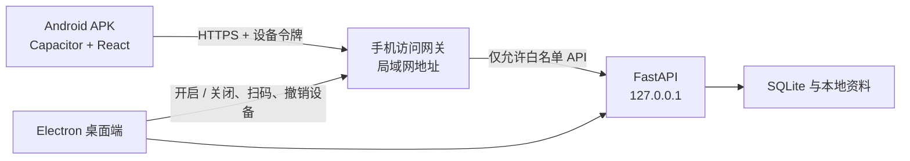

# StudyPilot Desk 手机访问与 Android APK 架构

## 结论

Android 端采用 **Capacitor + 现有 React 前端**。桌面端仍是数据主机；用户在设置中主动开启“手机访问”，手机扫码配对后，在电脑在线时查看课程、统计、资料、知识笔记与知识图谱。

不直接把 Electron 移植到 Android，也不建议重写 React Native。Capacitor 可以复用现有组件、类型和 API Client，同时保留访问相机扫码、安全存储、网络状态等原生能力。

## 三种路线比较

| 路线 | 优点 | 代价 | 结论 |
| --- | --- | --- | --- |
| PWA | 最快验证，浏览器即可打开 | 不是完整 APK，后台与系统集成有限 | 可作为内部预览，不作为最终形态 |
| Capacitor Android | 最大化复用 React，能输出 APK/AAB，原生能力够用 | 需要移动布局和 Android 构建链 | **推荐** |
| Tauri Mobile | 包体小，安全边界清晰 | 引入 Rust 与另一套移动构建/插件体系 | 暂不选，除非以后统一迁移桌面壳 |

参考：[Capacitor 官方文档](https://capacitorjs.com/docs)、[Tauri Mobile 前置条件](https://v2.tauri.app/start/prerequisites/)。

## 运行拓扑



当前 FastAPI 只监听 `127.0.0.1`，这项默认必须保留。手机访问不能简单地把现有服务改成 `0.0.0.0`，否则关机接口、写入接口和本地资料都会直接暴露给同一网络中的其他设备。

正确做法是增加一个由 Electron 管理的独立网关：

1. 默认关闭，仅在用户主动开启时监听当前局域网地址。
2. 网关只转发手机端需要的 API，不转发内部关机、Python 执行、备份恢复等高风险接口。
3. 首版令牌默认只读；后续需要编辑时按能力单独授权。
4. Electron 退出、电脑休眠、切换网络或用户关闭功能时，网关立即停止。

## 配对与安全

桌面端显示二维码，内容包含电脑标识、局域网地址、一次性配对码和服务器公钥指纹。二维码不包含长期访问密钥。

配对流程：

1. 手机扫描二维码并请求一次性配对。
2. 桌面弹出设备名称，用户在电脑上确认。
3. 网关签发设备令牌；手机使用 Android Keystore 安全保存。
4. 服务端只保存令牌哈希，可在桌面设置中查看最后访问时间并随时撤销。
5. 访问令牌短时有效，刷新令牌绑定设备；连续失败触发限流。

正式版本使用 HTTPS。Android 官方明确指出明文 HTTP 流量可能被同网设备读取或篡改，并且 Android 9 起默认禁用明文流量；不要为了省事全局开启 `cleartextTrafficPermitted`。开发构建可以只给调试目标配置例外。参考：[Android 网络安全配置](https://developer.android.com/privacy-and-security/security-config)、[明文通信风险](https://developer.android.com/privacy-and-security/risks/cleartext-communications)。

Android 17 / API 37 开始，本地网络访问需要处理新的局域网权限状态；WebView 的局域网请求继承宿主应用权限。参考：[Android 本地网络权限](https://developer.android.com/privacy-and-security/local-network-permission)。

## “电脑在线”的两种范围

### 同一 Wi-Fi（第一阶段）

手机与电脑位于同一局域网，二维码直接连接电脑。没有云成本，数据不离开本地，适合第一版。

### 不同网络（第二阶段）

仅仅“电脑在线”并不足以让外网手机找到它。不要要求用户做路由器端口映射。可选方案：

- 个人/内测：通过 Tailscale 或同类私有网络连接，风险和开发量最低。
- 产品化：增加云端信令与加密中继。云端只转发端到端加密的数据，不持有课程明文；电脑离线时手机明确显示“主机离线”。

## Android 第一版范围

第一版做只读查看，优先保证小屏体验和稳定性：

- 主机配对、网络状态、离线提示、手动重连。
- 课程列表、课程主页、学习统计。
- 知识笔记列表、知识图谱缩放/平移、卡片与图片全屏查看。
- 资料列表与正文阅读。
- 最近一次成功访问的轻量缓存；敏感正文默认不长期离线保存。

暂不迁移 Python 实验室、桌面文件导入、备份恢复、大画布复杂编辑和系统设置。第二阶段再加入任务勾选、掌握度调整、便签编辑，并通过版本号/ETag 处理电脑与手机同时编辑的冲突。

## 代码落点

建议保持单仓库：

```text
frontend/src/                 共享 React 组件、类型、API Client
frontend/src/mobile/          手机路由、配对页、小屏页面组合
mobile/android/               Capacitor Android 工程
electron/mobile-gateway.ts    网关生命周期、局域网地址与防火墙提示
backend/app/mobile/           配对、令牌、设备与只读 API 白名单
```

现有 `ApiClient(baseUrl)` 已具备切换服务地址的基础。下一步需要增加可插拔的鉴权头、移动端运行时配置、网络超时/重试与取消请求；现有 Electron 的 `window.studypilot.runtime()` 则保留为桌面专用启动方式。

## 分阶段验收

### M1：局域网只读原型

- Android 真机扫码后能连接 Windows 主机。
- 未配对设备访问全部返回 401；关闭手机访问后端口不可达。
- 可查看课程、统计、知识笔记、图片和图谱。
- 桌面现有功能与本地性能不受影响。

### M2：可安装发布包

- 生成签名 APK 和 AAB；深色/浅色、刘海屏、返回手势适配完成。
- 设备令牌进入 Keystore，桌面可撤销，网络变化可自动恢复。
- Android 9—17 的 HTTPS、本地网络权限和生命周期测试通过。

### M3：有限编辑与远程访问

- 任务、掌握度和便签编辑支持冲突检测。
- 可选私有网络或端到端加密中继；禁止公网裸端口。
- 增加访问日志、限流、设备管理和密钥轮换。
