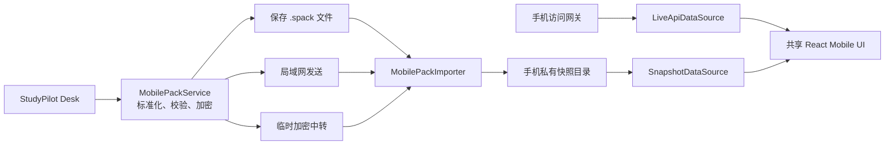

# StudyPilot Mobile 与加密数据包设计规格

日期：2026-07-18  
状态：产品方向已确认，等待书面规格复核  
适用项目：StudyPilot Desk / StudyPilot Mobile

## 1. 决策摘要

StudyPilot Mobile 使用 Capacitor Android 壳复用现有 React、类型定义和视觉系统。首个版本提供两种只读数据源：

1. **离线快照**：手机导入 `.spack` 数据包后，在电脑离线时查看课程、任务、统计、资料、知识笔记、知识图谱和图片。
2. **实时主机**：与桌面配对且电脑在线时，从受保护的手机访问网关读取最新数据。

首版手机端不编辑桌面数据。重复导入同一台电脑的新快照时，完整替换该来源的旧快照；不按标题猜测合并，也不实现双向同步。

`.spack` 是唯一数据交换格式。保存文件、局域网发送和网站加密中转只是三种运输通道，共用同一个导出、验证与导入引擎。

## 2. 目标与非目标

### 2.1 目标

- 从当前仓库构建可安装的 Android APK。
- 一次操作选择全部课程或指定课程，生成面向手机的只读数据包。
- 手机通过文件、二维码中转链接或局域网接收同一种数据包。
- 手机在完全离线时浏览已导入内容。
- 数据包被篡改、截断、损坏或版本不兼容时安全拒绝，不污染已有快照。
- 同一来源重复导入具备明确的预览、替换和失败回滚行为。
- 大图片和大资料采用流式处理，避免桌面或手机界面卡死。

### 2.2 非目标

- 首版不支持手机编辑、冲突合并、双向同步或云端永久资料库。
- 不在手机执行 Python，不导出 Python 环境、运行进程或本机绝对路径。
- 不把现有原始 SQLite 备份直接导入手机。
- 不通过公网裸端口访问桌面后端。
- 不以课程标题、节点标题或内部整数 ID 作为跨设备身份。

## 3. 为什么不能复用现有备份

当前备份包含 `app.db`、文档目录、媒体目录和 `manifest.json`，其恢复语义是覆盖桌面数据库。它适合灾备，但不适合手机：

- 携带手机不需要的内部表、设置与本地路径。
- 依赖 SQLite schema 和内部自增整数 ID。
- 恢复操作会替换整库，没有来源快照或更新语义。
- 手机为了读取它必须复制桌面数据库结构，后续迁移风险高。

因此，桌面备份格式保持不变；手机数据包由独立的 `MobilePackService` 生成标准化实体。

## 4. 总体架构



### 4.1 共享前端边界

移动端不直接依赖 Electron 的 `window.studypilot.runtime()`。共享 UI 通过 `StudyDataSource` 接口读取数据：

```ts
interface StudyDataSource {
  mode: "live" | "snapshot";
  listCourses(): Promise<CourseSummary[]>;
  getCourse(id: string): Promise<CourseDetail>;
  getToday(courseId: string): Promise<TodaySnapshot>;
  getStats(courseId: string): Promise<LearningStatsSnapshot>;
  listNotebooks(courseId: string): Promise<NotebookSummary[]>;
  getKnowledgeGraph(notebookId: string): Promise<PortableKnowledgeGraph>;
  listDocuments(courseId: string): Promise<DocumentSummary[]>;
  getDocument(id: string): Promise<PortableDocument>;
}
```

- `LiveApiDataSource` 使用带设备令牌的 HTTP API。
- `SnapshotDataSource` 从手机私有目录中的 JSONL 和资源文件读取。
- 页面只依赖接口，不关心数据来自电脑还是离线包。

首版快照是只读文件集合，不引入移动 SQLite。这样避免额外插件与 schema 同步；按课程拆分的 JSONL 可流式读取并按需缓存。真正引入手机编辑时再为操作日志选择数据库。

### 4.2 Android 工程

```text
frontend/src/shared/                 共享模型、格式化器和通用组件
frontend/src/mobile/                 手机路由、页面与数据源适配器
mobile/                              Capacitor 配置
mobile/android/                      Android Studio 工程
backend/app/services/mobile_pack.py  数据包导出
backend/app/mobile/                  配对、设备、网关白名单
electron/mobile-transfer.ts          导出保存、二维码和传输状态
```

Android application id 使用 `app.studypilot.mobile`。最低支持 Android 9 / API 28，并持续测试至 Android 17 / API 37。

## 5. 可移植身份

所有可传输实体增加不可变 `public_id`，使用 UUIDv7 字符串：

- courses
- phases / weeks / tasks
- knowledge_notebooks / knowledge_nodes / knowledge_edges
- documents / document_highlights / media_assets
- notes / captures

数据库迁移为现有记录补齐 UUID。新记录创建时立即生成。外键在数据包内使用 `public_id`，内部整数 ID 永不离开桌面导出边界。

每个桌面安装实例增加 `source_instance_id`，存放在应用数据目录且不会因课程改名变化。每次导出生成新的 `snapshot_id` 和递增 `snapshot_revision`。

手机使用 `(source_instance_id, snapshot_revision)` 判断更新：

- 新来源：创建独立来源资料库。
- 同来源更高 revision：显示变化摘要，确认后替换。
- 同 revision：提示已导入，不重复写入。
- 更低 revision：默认拒绝降级，可通过明确的“恢复旧快照”操作覆盖。

## 6. `.spack` 文件格式

`.spack` 是外层 ZIP，但外层只允许两个固定条目：

```text
envelope.json
payload.bin
```

`envelope.json` 不包含课程名称、笔记正文或文件名，仅包含解密所需的非敏感信息：

```json
{
  "format": "app.studypilot.spack",
  "format_version": 1,
  "crypto_suite": "secretstream-xchacha20poly1305-v1",
  "key_mode": "link-fragment | paired-device | passphrase",
  "kdf": null,
  "stream_header": "base64url",
  "payload_size": 123456,
  "created_at": "2026-07-18T12:00:00Z"
}
```

`payload.bin` 是使用 libsodium secretstream 分块加密的内层 ZIP。内层结构：

```text
manifest.json
entities/courses.jsonl
entities/tasks.jsonl
entities/notebooks.jsonl
entities/knowledge-nodes.jsonl
entities/knowledge-edges.jsonl
entities/documents.jsonl
entities/highlights.jsonl
derived/today.json
derived/stats.json
assets/<sha256>.<safe-extension>
```

JSONL 每行一个对象，便于流式导出、校验和读取。资源以内容 SHA-256 命名以自然去重；实体通过 asset hash 引用资源。

`envelope.json` 按 `key_mode` 使用互斥参数，解析时拒绝多余字段：

- `link-fragment`：envelope 不包含内容密钥；32 字节随机密钥只存在于二维码/App Link fragment。
- `paired-device`：包含目标设备 `key_id` 和使用目标 X25519 公钥生成的 sealed content key；只有目标手机能解封。
- `passphrase`：包含 16 字节随机 salt、Argon2id 参数（64 MiB、3 次迭代、并行度 1）和随机内容密钥的加密封装；不直接以口令作为流密钥。

外层 envelope 属于不可信输入，仅允许 64 KiB，必须在 payload 完整通过 AEAD 验证后才把其中的展示信息视为可信。

### 6.1 manifest

解密后首先验证 `manifest.json`：

```json
{
  "format": "app.studypilot.mobile-snapshot",
  "format_version": 1,
  "minimum_app_version": "0.1.0",
  "pack_id": "uuidv7",
  "snapshot_id": "uuidv7",
  "snapshot_revision": 12,
  "source_instance_id": "uuidv7",
  "source_device_name": "My Study PC",
  "created_at": "2026-07-18T12:00:00Z",
  "scope": { "kind": "selected_courses", "course_ids": ["uuidv7"] },
  "counts": { "courses": 2, "tasks": 48, "nodes": 126, "assets": 18 },
  "files": [
    { "path": "entities/courses.jsonl", "size": 2048, "sha256": "..." }
  ],
  "unpacked_size": 18432000
}
```

manifest 的 `files` 是内层 ZIP 的完整允许列表。未列出的文件、重复路径、绝对路径和包含 `..` 的路径一律拒绝。

### 6.2 导出范围

桌面导出向导提供：

- 全部课程。
- 选择课程。
- 默认包含任务、路线、知识笔记、统计和资料正文。
- 图片与附件显示估算体积，可单独关闭“原始资料文件”；关闭后仍导出文字索引和图片缩略图。

永不导出：访问令牌、设备密钥、应用设置、回收站内容、备份文件、Python 环境、Python 运行输出、本机绝对路径和桌面窗口状态。

## 7. 三种运输通道

### 7.1 文件

桌面保存 `.spack`，用户可通过 USB、网盘或系统分享传递。敏感包不允许“无密码明文导出”：

- 已配对设备：内容密钥封装给目标手机公钥。
- 未配对设备：用户设置至少 12 个字符的口令，使用 Argon2id 派生内容密钥。

Android 注册 `.spack` MIME 与打开文件 Intent。用户在文件管理器或聊天应用中选择“使用 StudyPilot 打开”，App 只通过 Content URI 流式读取，不申请整个共享存储权限。

### 7.2 局域网发送

已配对且同网时，桌面“发送到手机”直接把同一个加密 `.spack` 流交给手机。传输经过认证 HTTPS 网关；手机公钥用于封装内容密钥。失败可从已确认分块继续，不改数据包内容。

### 7.3 临时加密中转

桌面本地生成随机内容密钥并完成加密后，仅上传密文。中转服务返回 `transfer_id`，桌面展示 Android App Link 二维码：

```text
https://transfer.studypilot.app/t/<transfer_id>#<base64url-content-key>
```

URL Fragment 不进入 HTTP 请求、对象存储键或服务端访问日志。网页必须是无分析脚本的静态落地页，不能读取或上传 fragment。

中转规则：

- 默认 30 分钟过期，最大 24 小时。
- 最多允许 3 次完整下载，以支持弱网重试。
- 手机完成解密、校验和原子导入后发送确认，服务端立即删除密文。
- 未确认时由 TTL 自动清理。
- 支持分块上传、Range 下载和断点续传。
- 服务端限制单包 1 GiB；更大数据包提示使用局域网或文件方式。

安装 APK 后，验证过的 Android App Link 直接进入导入页；未安装时落地页只显示安装说明与“安装后重新扫描”，不在浏览器解密数据。

## 8. 手机信息架构与 UX

### 8.1 首次启动

1. 品牌启动页，随后进入“连接电脑 / 导入数据包”。
2. 连接电脑：扫描桌面配对二维码，进入实时只读模式。
3. 导入数据包：扫描中转二维码、打开 `.spack` 或输入传输链接。
4. 成功后进入手机主页，不强制注册云账号。

### 8.2 主导航

底部四项：

- 首页：今日任务、继续学习、主机状态。
- 课程：课程列表与课程主页。
- 笔记：知识笔记、图谱和资料。
- 统计：连续天数、完成率、活动趋势和资产概览。

“更多”放在首页头像菜单中，包含数据来源、导入记录、已配对电脑、主题与缓存管理，避免五项底栏拥挤。

### 8.3 数据来源状态

所有页面顶部使用紧凑状态胶囊：

- `实时 · 主机在线`
- `离线快照 · 更新于 18:32`
- `主机离线 · 正在显示最近快照`

实时模式断开时，如果存在同来源快照，无需弹阻塞错误，自动切换并显示一次轻提示。用户可手动重试实时连接。

### 8.4 导入流程

```text
获取包 → 解密 → 校验 → 预览 → 导入暂存区 → 原子替换 → 完成
```

预览页展示来源电脑、导出时间、课程名称、内容数量、资源体积和新旧 revision。替换旧快照前明确显示“手机上的旧离线副本会被替换；电脑数据不受影响”。

知识图谱在手机上支持双指缩放、单指平移、点按卡片打开底部详情、点按图片全屏查看；首版隐藏编辑、连线、删除和尺寸控制。

## 9. 原子导入与错误恢复

手机私有目录：

```text
snapshots/index.json
snapshots/<source_instance_id>/current/
snapshots/<source_instance_id>/staging-<snapshot_id>/
snapshots/<source_instance_id>/previous/
```

导入规则：

1. 在 staging 目录流式解密、解压并逐文件校验。
2. 验证所有实体 schema、引用 UUID、计数和资源 hash。
3. 只有全部成功才把 current 原子切换到 previous，再把 staging 切换为 current。
4. 更新 `index.json` 使用写临时文件后 rename 的方式提交。
5. 新快照成功打开一次后清理 previous；失败则自动回滚。

用户取消、应用进入后台或进程被杀时保留可恢复传输状态，但清理不完整的明文 staging。恢复时从密文下载/文件读取阶段继续，解密导入重新开始。

## 10. 安全边界

- 使用成熟的 libsodium secretstream 实现，不自行设计加密算法。
- 手机长期设备私钥进入 Android Keystore；数据库和 JS 层只持有公钥与 key alias。
- 加密、解密、hash 和压缩在 Worker / 原生线程执行，UI 线程只接收进度。
- 外层 ZIP 只允许两个固定条目；内层只允许 manifest 白名单。
- 最大解包 2 GiB、单文件 256 MiB、文件数 20,000、压缩比 100:1。
- 解压目标必须位于 staging 根目录，拒绝符号链接、硬链接和路径穿越。
- 图片和正文渲染使用已有安全策略；导入 HTML 只作为纯文本，不执行脚本。
- 中转服务不保存解密密钥、课程元数据或设备令牌，不接入第三方分析脚本。
- 手机访问网关保持独立于桌面内部 API，永不暴露关机、备份恢复和 Python 执行接口。

## 11. 性能预算

- 导出和导入全程流式处理，单次缓冲不超过 16 MiB。
- 进度至少每 250 ms 更新一次，但 UI 不因高频事件重渲染整个页面。
- 250 MiB 数据包在参考中端 Android 设备上应在 90 秒内完成本地导入。
- 10,000 个知识节点的快照索引不一次性渲染；列表虚拟化，图谱按可视区域裁剪。
- 图片生成 320 / 960 / 原图三档资源；列表使用缩略图，全屏查看才读取大图。
- 导出期间桌面主界面保持可交互，SQLite 使用一致性只读事务，不长时间阻塞写入。

## 12. 测试策略

### 12.1 数据包

- 相同数据库快照生成确定的实体内容和非确定的安全密文。
- public_id 引用、资源 hash、manifest 白名单和版本兼容测试。
- 截断、篡改、重复块、错误密钥、错误口令、非法路径、ZIP bomb 和超限文件测试。
- 老版本格式升级和新版本最低 App 版本拒绝测试。

### 12.2 导入

- 首次导入、同来源升级、重复 revision、旧版降级和不同来源并存。
- 导入中断、磁盘不足、应用被杀、资源损坏和回滚。
- current 切换前任何错误都不得改变可见快照。

### 12.3 Android

- Android 9、12、14、16、17 模拟器/真机矩阵。
- Content URI 打开文件、App Link、扫码、后台恢复、深浅主题和系统返回手势。
- 无网络、弱网、切换 Wi-Fi、主机休眠和主机离线回退。

### 12.4 端到端

- 桌面选择课程 → 导出 `.spack` → Android 导入 → 离线浏览课程/统计/图谱/图片。
- 桌面更新内容 → 导出更高 revision → 手机预览变化并替换。
- 桌面上传密文 → 扫描 App Link → 下载导入 → 确认删除中转对象。

## 13. 交付阶段

### 阶段 A：可移植数据基础

- 数据库增加 public_id、source_instance_id 和 snapshot revision。
- 实现 portable schema、MobilePackService、流式导出和验证器。
- Electron 增加“导出到手机”入口和文件保存。

### 阶段 B：首个 APK

- 初始化 Capacitor Android 工程。
- 建立 mobile 路由、StudyDataSource、SnapshotDataSource。
- 完成 `.spack` 文件导入、预览、原子替换和离线只读页面。
- 产出 debug APK 并进行真机验收。

### 阶段 C：一键二维码中转

- 实现临时密文中转 API、对象生命周期和断点续传。
- 配置 Android App Links 与无脚本落地页。
- 桌面展示二维码，手机扫描后一键导入。

### 阶段 D：实时连接与局域网发送

- 实现配对、设备密钥、手机访问网关和 LiveApiDataSource。
- 同网直接发送 `.spack`，实时/快照自动切换。
- 桌面设备管理、撤销与访问日志。

## 14. 首个可交付版本验收

- Windows 桌面可选择课程并成功导出加密 `.spack`。
- Android APK 可通过系统文件选择器打开数据包。
- 用户看到来源、时间、课程和数量预览后才能导入。
- 飞行模式下能查看课程主页、今日任务、统计、资料、知识笔记、图谱与图片。
- 重复导入同来源更高 revision 后只保留新快照，旧快照可在失败时回滚。
- 任何校验失败不会显示部分导入内容。
- 全量前后端测试、包格式安全测试、Android 构建和至少一台真机验收通过。
